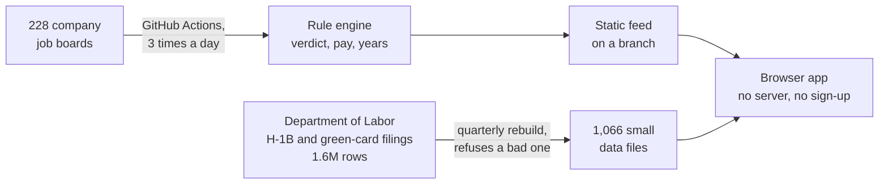

<h1 align="center">Thea Wu</h1>

  <b>Strategy, go-to-market and applied AI, built on data</b> 
  M.S. Data Science, Columbia University (Dec 2026) · New York area

  <a href="https://chengwu-data.github.io/">Website</a> ·
  <a href="https://chengwu-data.github.io/projects/sponsorscope/">SponsorScope case study</a> ·
  <a href="https://www.linkedin.com/in/thea-wu-1ab27922a/">LinkedIn</a> ·
  <a href="mailto:cheng.w@columbia.edu">Email</a>

I take a messy business decision and find the smallest analysis that changes it: which accounts to prioritize, which price to test, which posting is worth a week of interviews. My background is econometrics and data science, and I work best where analytics meets pricing, customer strategy, revenue operations and AI tools that people actually use.

I'm graduating in December 2026 and looking for full-time roles in **GTM and revenue operations, strategy and business operations, AI deployment and product operations**, based in New York.

---

## Live from my own project

I built [SponsorScope](https://chengwu-data.github.io/sponsorscope/), a job inbox that rules out roles that can't hire an international student. It scans company job boards every day. A GitHub Action in this repo reads what the scan found and rewrites the section below three times a day, so these numbers are real and current, not a screenshot.

<!-- SS:START -->

My scan read **228 company job boards (39,023 open roles)** and found **12 new roles in the last 24 hours**, of which **2** clear my limits. Roles with an Apply verdict in the last 7 days, by direction:

| Direction | Apply roles |
|---|---:|
| Product, growth & customer analytics | 19 |
| Product operations & strategy | 12 |
| GTM & revenue operations | 10 |
| Strategy & business operations | 9 |
| AI deployment & automation | 8 |
| Solutions & value consulting | 7 |
| Customer strategy & commercial ops | 3 |

Updated Nov 27, 2026, 10:54 PM ET by a GitHub Action in this repo.
<!-- SS:END -->

---

## SponsorScope in one minute

It reads tens of thousands of open roles from 228 company job boards, finds the sentence in each posting that says whether the company sponsors visas, checks pay and experience against my own limits, and adds the company's H-1B filing history for that role type. Every verdict shows the words behind it.

**How I checked it.** I labeled real posting sentences by hand and tested the rules on companies they had never seen.

| Test set | Sentences | Accuracy | Skip precision |
|---|---:|---:|---:|
| Development, 63 boards | 242 | 99.6% | 100% |
| Blind test 1, 42 new boards | 223 | 84.3% | 83.1% |
| Blind test 2, 35 new boards | 101 | 89.1% | 100% |

The blind numbers are the honest ones. Each blind test exposed a rule that was wrong, I fixed it and kept a regression test; after the fixes both sets score 97–98%, but they're no longer blind. I also re-counted H-1B filings for several companies straight from the Department of Labor's raw spreadsheets, and the totals matched.

<b>What I learned before building it</b>

 

I didn't have time for interviews, so I read and counted 36 public posts by international job seekers.

- 10 of 36 described reaching the final round, or signing an offer, before sponsorship ended it. So the verdict answers "is this worth a week of interviews?".
- People who landed offers had applied to 400 to 965 roles. So the goal became making volume cheap, not applying less.
- 8 of 36 posts were "sponsor lists" sold for a comment or a follow. So the tool is free, with no sign-up, and every verdict shows its source sentence.

<b>What it can't do yet</b>

 

- It filters by title first, so a role can still turn out off-target once the description is read.
- 74 Workday sites are connected, so coverage of large employers is partial.
- A filing is a request, not an approval: company history is evidence about the past, not a promise about a role.

[Try it](https://chengwu-data.github.io/sponsorscope/) · [Read the case study](https://chengwu-data.github.io/projects/sponsorscope/) · [Code and tests](https://github.com/ChengWu-Data/chengwu-data.github.io/tree/main/sponsorscope)

---

## Other work

| Project | What it is |
|---|---|
| [MultiDocRAG](https://github.com/ChengWu-Data/MultiDocRAG) | Question answering over many PDFs with retrieval and a refusal rule. I built a 27-question benchmark and raised grounded-answer accuracy from 62% to 87%. |
| [SF crime and neighborhood data](https://github.com/ChengWu-Data/sf-crime-socioeconomic-analysis) | Panel and count models linking 900k+ police incidents to census data by tract and year. |
| [USD/CAD trend strategy](https://github.com/ChengWu-Data/Exponential-Smoothing-Trend-Strategy-with-Parameter-Tuning-Exit-Rules) | Exponential-smoothing signals with a full parameter search and trade-level evaluation; Sharpe ratio rose from 0.26 to 0.45. |
| [Housing price analysis](https://github.com/ChengWu-Data/Housing-Price-Prediction-An-Exploratory-Analysis) | Ridge, LASSO and random forest on the Ames housing data to find what drives price. |
| [Iris recognition](https://github.com/ChengWu-Data/iris-recognition-system) | A classical biometric pipeline from a 2003 paper, built from scratch for a Columbia course. |

---

## How I work

- **Research first.** I start from what users actually do and say, then write the spec.
- **Measure before claiming.** Nothing goes on a page until it has passed a blind test, an independent re-count, or a real posting I read myself.
- **Say what it can't do.** Every project of mine has a limits section.
- **AI as a pair programmer.** I define the problem, the rules and the tests; Claude Code writes much of the code at my direction, and I check what it produces the way I'd check an analyst's work.

## Tools

**Analysis:** Python, SQL, R, Stata, Excel  
**Modeling:** scikit-learn, XGBoost, causal inference and experiment design  
**Data and apps:** PySpark, dbt, Streamlit, Power BI, Tableau  
**AI:** LangChain, FAISS, Sentence-Transformers, Claude Code

---

  <a href="https://chengwu-data.github.io/">chengwu-data.github.io</a> · cheng.w@columbia.edu

